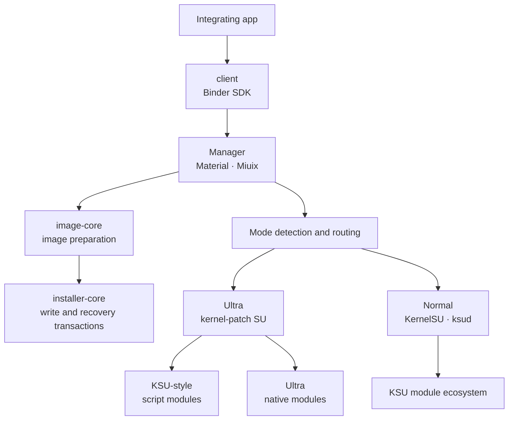

<div align="center">

<picture>
  <source media="(prefers-color-scheme: dark)" srcset="docs/assets/brand/maplesu-dark.png">
  
</picture>

### Kernel-level control. Two work modes. A real kernel manager.

Ultra grants SU through kernel patches; Normal carries the KernelSU module ecosystem. One manager runs both, and you switch between them as you need.

[](#compatibility)
[](#compatibility)
[](#compatibility)
[](LICENSE)
[](https://t.me/KernelMapleSU)

[简体中文](README.md) · **English**

[Documentation](docs/README.md) · [Architecture](docs/ARCHITECTURE.md) · [Build](docs/BUILD.md) · [SDK](docs/SDK.md) · [Modules](docs/MODULES.md) · [Contributing](CONTRIBUTING.md)

</div>

## MapleSU

MapleSU brings kernel-level root, application authorization and module management into one Android manager. **Ultra** takes the kernel-patch route: it generates a patch for the running kernel on the device, rebuilds the boot image and authorizes through a dedicated SU runtime. **Normal** integrates KernelSU's kernel implementation and module ecosystem. Both share a customizable Material / Miuix interface, and switching between them happens inside the manager.

MapleSU targets ARM64 devices running Android 12 or later. See the [build guide](docs/BUILD.md) for build and integration requirements.

## Features

### Two work modes

<table>
<tr>
<td width="50%" valign="top">

<picture>
  <source media="(prefers-color-scheme: dark)" srcset="docs/assets/brand/ultra-dark.png">
  
</picture>

**MapleSU Ultra** · kernel-patch SU

- Patches the kernel for SU authorization, with the kernel implementation maintained by MapleSU
- With no modules installed: 0 visible SELinux policy changes, 0 mounts and SELinux globally Enforcing
- Eliminates side-channel signatures from policy changes and mounts at the kernel level
- Generates the patch for the running kernel and rebuilds the boot image on the device
- Runs KSU-style script modules and supports Ultra native modules

</td>
<td width="50%" valign="top">

<picture>
  <source media="(prefers-color-scheme: dark)" srcset="docs/assets/brand/normal-dark.png">
  
</picture>

**MapleSU Normal** · KernelSU kernel implementation

- Built on KernelSU, with integration into the KSU module ecosystem
- KSU modules install and run through their usual `ksud` lifecycle
- Selects the LKM by KMI and prepares the boot image through KernelSU's installation path
- Keeps KernelSU's superuser, module and settings interfaces

</td>
</tr>
</table>

Both modes share one management interface, with dedicated installation and runtime paths:

| | MapleSU Ultra | MapleSU Normal |
| --- | --- | --- |
| Root architecture | Kernel-patch SU, with target-kernel patch generation, runtime authorization and native-module integration | KernelSU kernel implementation, with a dedicated `ksud` integration |
| Installation | On-device patching and rebuilding of the existing boot kernel | KMI-matched LKM and boot-image ramdisk preparation |
| Modules | KSU-style script modules and Ultra native modules, with separate execution paths | KSU module ecosystem and lifecycle |
| Runtime | Kernel-backed SU and versioned native SDK adapters; provider-backed temporary root on supported targets | KernelSU superuser, module and settings interfaces |

See the [module guide](docs/MODULES.md) and [Ultra native module guide](docs/ULTRA_MODULES.md) for development and integration.

### Control from kernel to app

<table>
<tr>
<td width="50%" valign="top">
<b>A lean Ultra core</b><br>
With no modules installed: 0 visible SELinux policy changes, 0 mounts and SELinux globally Enforcing. Module policies and module mounts are managed separately, according to the features you enable.
</td>
<td width="50%" valign="top">
<b>Signatures removed at the kernel level</b><br>
No reliance on surface-level disguise: side-channel signatures from policy changes and mounts are eliminated in the kernel.
</td>
</tr>
<tr>
<td width="50%" valign="top">
<b>On-device kernel preparation</b><br>
Ultra resolves patch sites against the target kernel, checks patch records and rebuilds the boot image with input and output digests.
</td>
<td width="50%" valign="top">
<b>Installation with recovery in mind</b><br>
Image preparation and partition writes run in distinct stages: preflight checks, backups, journals, synchronized writes and readback. Recovery uses the retained journal and original data.
</td>
</tr>
<tr>
<td width="50%" valign="top">
<b>Dynamic application authorization</b><br>
Grant and revoke root access per app. Supported backends read the authorization table back after each write and restore existing grants at boot; the application SDK checks the caller's real UID and app identity before starting a session.
</td>
<td width="50%" valign="top">
<b>Traceable mode switching</b><br>
A switch runs through preflight, snapshots, candidate preparation, journaled installation and post-boot verification, and retains its operation identity and recovery state across interruptions.
</td>
</tr>
</table>

### A shared management experience

<table>
<tr>
<td width="50%" valign="top">
<b>Material and Miuix interfaces</b><br>
Choose either interface, with themes, wallpapers and personalization settings.
</td>
<td width="50%" valign="top">
<b>Modules and WebUI</b><br>
Install, update, enable and remove modules from one place, with package inspection and integrated module WebUIs.
</td>
</tr>
<tr>
<td width="50%" valign="top">
<b>Application SDK</b><br>
Binder root sessions with standard input/output, exit status, cancellation and terminal control. Clients verify the Manager's signing certificate and receive session handles, never backend credentials.
</td>
<td width="50%" valign="top">
<b>Community catalogs</b><br>
Discover modules through signed catalogs with package size and digest checks, and customize the manager with community themes. Separate module and theme repositories give authors clear contribution and maintenance workflows.
</td>
</tr>
</table>

## Compatibility

| Item | Details |
| --- | --- |
| System | Android 12 or later |
| Architecture | ARM64 (arm64-v8a) |
| Kernel | Ultra renders its patch recipe per kernel series, currently GKI 5.10, 5.15, 6.1, 6.6, 6.12 and 6.18; Normal uses KMI-matched KernelSU components |
| Installation | Direct installation through an existing root channel; temporary root through a compatible provider on supported targets |
| Modules | Compatibility follows the selected mode, backend version and required kernel interfaces; see [module compatibility](docs/MODULE_COMPATIBILITY.md) |

Device support and release status are defined per version. See the [architecture overview](docs/ARCHITECTURE.md) for the execution paths and component design.

## Architecture at a glance



## Getting started

| Goal | Guide |
| --- | --- |
| Understand the codebase | [Architecture](docs/ARCHITECTURE.md) |
| Integrate root sessions into an app | [SDK guide](docs/SDK.md) · [Client library](client/) · [Example app](consumer/) |
| Write or adapt a module | [Module guide](docs/MODULES.md) |
| Develop Ultra native modules | [Ultra native module guide](docs/ULTRA_MODULES.md) |
| Submit and maintain themes | [Theme repository guide](docs/THEME_REPOSITORY.md) |
| Submit and maintain modules | [Module repository guide](docs/MODULE_REPOSITORY.md) |
| Build and run checks | [Build guide](docs/BUILD.md) · [Testing](docs/TESTING.md) |
| Contribute or report an issue | [Contributing](CONTRIBUTING.md) · [Security](SECURITY.md) |
| Review maintenance and releases | [Maintenance](docs/MAINTENANCE.md) · [Release process](docs/RELEASING.md) |
| Check sources and licenses | [Credits](CREDITS.md) · [NOTICE](NOTICE) · [Dependency inventory](third_party/DEPENDENCIES.md) |

The architecture overview is in English. Other detailed guides are currently maintained in Simplified Chinese.

Run the image and installation transaction checks using synthetic inputs, without an Android device or private images:

```shell
python tools/check_host.py
```

Check module dependencies, native-loading sites and the documentation against the [architecture overview](docs/ARCHITECTURE.md):

```shell
python tools/check_architecture.py
```

Build the Android client SDK:

```shell
./gradlew :maplesu-client:assembleRelease
```

Use `./gradlew.bat` in Windows PowerShell. The [build guide](docs/BUILD.md) lists the toolchain, native inputs and output paths for each component. The repository retains the native SDKs, paired backend, kernel inputs and symbols used by the complete Manager build.

## About MapleSU

An Android root manager with two work modes you can switch between. Developer: **MapleAutumn**.

<div align="center">
<a href="https://t.me/KernelMapleSU">
<picture>
  <source media="(prefers-color-scheme: dark)" srcset="docs/assets/brand/community-en-dark.png">
  
</picture>
</a>
</div>

### Acknowledgements

Thanks to the developers and contributors who share their code, designs and experience. The order matches the Manager's About MapleSU dialog.

| Project | Relationship to MapleSU |
| --- | --- |
| [FinaSU](https://github.com/LyraVoid/FinaSU) | Main reference for UI design and interaction |
| [KernelSU](https://github.com/tiann/KernelSU) | Primary implementation source and module ecosystem for Normal mode |
| [7kimisu](https://github.com/hartgerinktarcila-design/7kimisu) | Direct base of the manager, with original credits and licensing retained |
| [KernelPatch](https://github.com/bmax121/KernelPatch) | Open-source work and technical reference for kernel patching |
| [SKRoot](https://github.com/abcz316/SKRoot-linuxKernelRoot) | Reference for Ultra module adaptation and SU internals; the scope of component integration is in [Credits](CREDITS.md) |

### Implementation and provenance

What MapleSU implements and maintains, and what comes from upstream, recorded separately:

| Part | Implemented and maintained by MapleSU | Upstream origin |
| --- | --- | --- |
| Manager | Mode orchestration, installation transactions, image handling, restricted Binder sessions, client SDK, module inspection, theme and catalog integration, branding and both interfaces | Directly derived from 7kimisu; UI and interaction reference FinaSU |
| Normal | `ksud` integration, installation path and manager integration | Pinned KernelSU sources with recorded patches |
| Ultra | Patch-recipe generation, authorization transactions, SDK adapters and module compatibility records | The offline patch core and native SDK are pinned third-party components; component origins are in [Credits](CREDITS.md) |
| Module policy | Policy parsing, loading and optional backend preparation | Magisk-derived code and libsepol keep their original licenses |

See the [full credits](CREDITS.md), [NOTICE](NOTICE) and [dependency inventory](third_party/DEPENDENCIES.md) for fixed versions, source origins, modifications and component terms. Files derived from upstream retain their original authors, licenses and pinned sources. The comparison of the Manager's sources with the pinned upstream snapshot is reproducible with `python tools/check_architecture.py --report`; see [Origin of the code](docs/ARCHITECTURE.md#origin-of-the-code). Project names and trademarks belong to their respective owners; MapleSU is independently maintained and is not affiliated with or endorsed by these projects.

Special thanks to 小酒 (Xiaojiu), 晚风 (Wanfeng), [有希 (Youxi)](https://github.com/matsuzaka-yuki), [佐佐鱼 (Zuozuoyu)](https://github.com/Yutou04-sa) and [知秋 (Zhiqiu)](https://github.com/947409161), and to everyone who reports issues, maintains modules, shares themes and improves the documentation.

### MapleSU User Advisor Program

<div align="center">

</div>

No step of MapleSU was taken alone. At the centre of the wall is the author, MapleAutumn; avatars with a maple ring belong to the partners who gave MapleSU special help, and the rest to the beta testers whose contributions during the beta were invaluable. Thank you all. The same list lives in the Manager's About MapleSU, where tapping an avatar opens its introduction.

<details>
<summary>Members and contributions</summary>

<!-- advisors:start · generated by tools/brand/render_advisor_wall.py; edit manager/src/main/assets/maplesu/advisors/members.json -->

| Member | Role | About | Links |
| --- | --- | --- | --- |
| MapleAutumn | Author |  <br>“『时光流转，愿你能与珍爱之人再度重逢』🍁” | — |
| 晚风 | Special thanks · Beta tester | Behind-the-scenes supporter · Co-developer | [GitHub](https://github.com/bywanfeng) |
| 小酒 | Special thanks · Beta tester | Behind-the-scenes supporter · Co-developer | [Telegram](https://t.me/qingyu177) |
| 佐佐鱼 | Special thanks · Beta tester | Contributed to the jailbreak approach · Provided the 橘子7 privilege-escalation implementation <br>“如果有事通过🤖 @yutou\_004\_bot 联系我，私聊拉黑” | [GitHub](https://github.com/Yutou04-sa) · [Telegram](https://t.me/Yutou04) |
| 7kimimasy | Special thanks · Beta tester | Contributed to MapleSU's beta testing and promotion  | [GitHub](https://github.com/hartgerinktarcila-design) · [Telegram](https://t.me/kmimasy) |
| jianhua114514 | Beta tester | — | [Telegram](https://t.me/jianhua114514) |
| 临冬诗意渐渐 | Beta tester | — | — |
| 邵 | Beta tester | — | [Telegram](https://t.me/llopjky) |
| LinLeyu | Beta tester | — | [Telegram](https://t.me/linleyu_0v0) |
| 沧海 | Beta tester | “国一火泰斗火洛杉矶最强的火” | [Telegram](https://t.me/chgyh666) |
| qingmingnbi | Beta tester | — | [Telegram](https://t.me/qingmingnbi) |
| 奶霸 | Beta tester | — | — |
| 怪我怜悯一生 | Beta tester | — | [Telegram](https://t.me/hexciphc) |
| 木讷 | Beta tester | — | [Telegram](https://t.me/lzhabc) |
| LiMy | Beta tester | “手握日月摘星辰，世间无我这般人” | [Telegram](https://t.me/Lveuot) |
| 好好 | Beta tester | — | — |
| 簌雨辞风 | Beta tester | — | — |
| 小冯 | Beta tester | — | [Telegram](https://t.me/SukiUltra) |
| 浅陌 | Beta tester | — | — |
| 酸菜鱼 | Beta tester | — | [Telegram](https://t.me/SuancaiyuPro) |
| 66uM1 | Beta tester | — | [Telegram](https://t.me/Czh0106) |
| 疑问大猫 | Beta tester | — | — |

<!-- advisors:end -->

</details>

## License

The manager and original MapleSU code are provided under GPL-3.0-or-later; see [LICENSE](LICENSE). Third-party components retain their own terms, as described in [NOTICE](NOTICE). The project license does not grant rights to external SDKs or other third-party components.

Modules and themes are contributed and maintained by their authors, with separate source, asset and distribution records. See the [maintenance policy](docs/MAINTENANCE.md) for contributions, updates and issue handling. Report copyright concerns through an issue in the relevant module or theme repository.

## Before you flash

- MapleSU modifies the boot image and kernel behavior. Use it only on devices you own or are authorized to modify, and make a full backup before flashing.
- Unlocking the bootloader, rooting and modifying partitions can void warranties, lose data, break some apps or leave a device unable to boot. You accept these risks.
- Follow the laws and terms of service that apply to you. Do not use this project on unauthorized devices or for any unlawful purpose.

The project is provided "as is", without warranty of any kind; see [LICENSE](LICENSE).

<div align="center">
<br>
<em>『时光流转，愿你能与珍爱之人再度重逢』🍁</em><br>
<sub>As time flows on, may you meet again the ones you hold dear.</sub>
<br><br>
<sub>MapleSU · independently maintained by MapleAutumn</sub>
</div>
