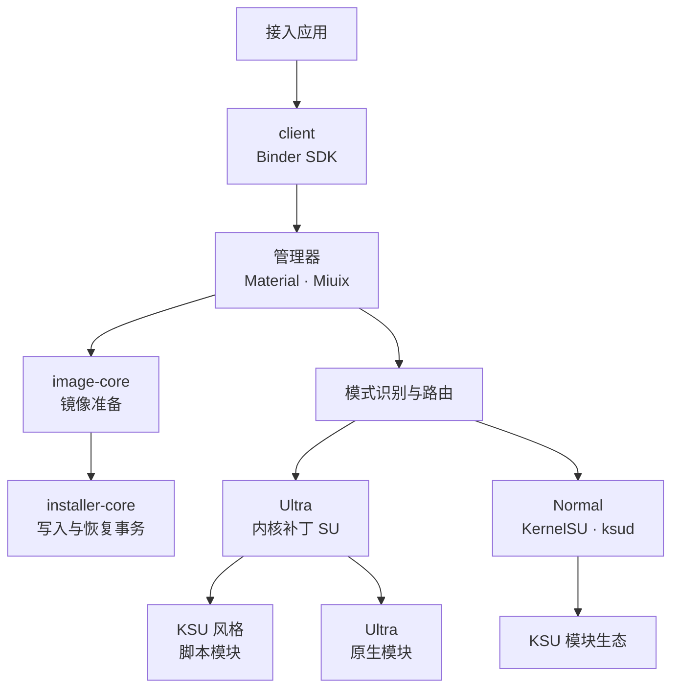

<div align="center">

<picture>
  <source media="(prefers-color-scheme: dark)" srcset="docs/assets/brand/maplesu-dark.png">
  
</picture>

### 内核级掌控 · 双工作模式 · 真正的内核管理器

Ultra 以内核补丁实现 SU 授权，Normal 承载 KernelSU 模块生态；两种模式共用一个管理器，按需切换。

[](#兼容性)
[](#兼容性)
[](#兼容性)
[](LICENSE)
[](https://t.me/KernelMapleSU)

**简体中文** · [English](README.en.md)

[文档](docs/README.md) · [架构](docs/ARCHITECTURE.md) · [构建](docs/BUILD.md) · [SDK](docs/SDK.md) · [模块](docs/MODULES.md) · [贡献](CONTRIBUTING.md)

</div>

## MapleSU

MapleSU 将内核级 Root、应用授权与模块管理整合进同一个 Android 管理器。**Ultra** 走内核补丁路线：在设备端为当前内核生成补丁、重建 boot 镜像，并由专用 SU 运行时完成授权；**Normal** 集成 KernelSU 的内核实现与模块生态。两种模式共享可定制的 Material / Miuix 界面，切换在管理器内完成。

MapleSU 面向 Android 12 及以上的 ARM64 设备。构建与集成要求见[构建指南](docs/BUILD.md)。

## 特性

### 双工作模式

<table>
<tr>
<td width="50%" valign="top">

<picture>
  <source media="(prefers-color-scheme: dark)" srcset="docs/assets/brand/ultra-dark.png">
  
</picture>

**MapleSU Ultra** · 内核补丁 SU

- 对内核进行补丁，实现 SU 授权，内核方案由 MapleSU 维护
- 零模块下，0 可见 SELinux 策略修改、0 挂载，全局保持 Enforcing
- 从内核层消除策略修改与挂载带来的侧信道特征
- 在设备端为当前内核生成补丁并重建 boot 镜像
- 运行 KSU 风格脚本模块，兼容 Ultra 原生模块

</td>
<td width="50%" valign="top">

<picture>
  <source media="(prefers-color-scheme: dark)" srcset="docs/assets/brand/normal-dark.png">
  
</picture>

**MapleSU Normal** · KernelSU 内核实现

- 以 KernelSU 作为底层实现，接入 KSU 模块生态
- KSU 模块沿用原有的 `ksud` 生命周期安装与运行
- 按 KMI 选择 LKM，经 KernelSU 安装路径准备 boot 镜像
- 沿用 KernelSU 的超级用户、模块与设置接口

</td>
</tr>
</table>

两种模式共用同一套管理界面，安装与运行路径各自独立：

<!-- 表格标签的汉字之间以 &#8288;（Word Joiner）连接，避免 GitHub 把短标签逐字折行。 -->
| | MapleSU Ultra | MapleSU Normal |
| --- | --- | --- |
| 架&#8288;构 | 内核补丁 SU：按目标内核生成补丁，运行时授权与原生模块接入 | KernelSU 内核实现，配合专门的 `ksud` 集成 |
| 安&#8288;装 | 在设备端修补并重建现有 boot 内核 | KMI 匹配的 LKM 与 boot 镜像 ramdisk 准备 |
| 模&#8288;块 | KSU 风格脚本模块与 Ultra 原生模块，执行路径相互独立 | KSU 模块生态与生命周期 |
| 运&#8288;行&#8288;时 | 内核支撑的 SU 与带版本的原生 SDK 适配；受支持的目标可使用提供方临时 Root | KernelSU 的超级用户、模块与设置接口 |

模块开发与适配见[模块指南](docs/MODULES.md)与 [Ultra 原生模块指南](docs/ULTRA_MODULES.md)。

### 从内核到应用

<table>
<tr>
<td width="50%" valign="top">
<b>精简的 Ultra 核心</b><br>
零模块下，0 可见 SELinux 策略修改、0 挂载，SELinux 全局保持 Enforcing。模块策略与模块挂载按你启用的功能单独管理。
</td>
<td width="50%" valign="top">
<b>从内核层消除特征</b><br>
不依赖表层伪装：策略修改与挂载带来的侧信道特征，在内核层面消除。
</td>
</tr>
<tr>
<td width="50%" valign="top">
<b>设备端内核准备</b><br>
Ultra 针对目标内核解析补丁位置、核对补丁记录，并记录输入与输出摘要，重建 boot 镜像。
</td>
<td width="50%" valign="top">
<b>为恢复而设计的安装</b><br>
镜像准备与分区写入分阶段进行：预检、备份、日志、同步写入与读回校验；恢复依赖保留的日志与原始数据。
</td>
</tr>
<tr>
<td width="50%" valign="top">
<b>动态应用授权</b><br>
按应用授予与撤销 Root。支持的后端在写入后读回授权表，并在开机时恢复已有授权；应用 SDK 建立会话前校验调用方的真实 UID 与应用身份。
</td>
<td width="50%" valign="top">
<b>可追踪的模式切换</b><br>
切换经过预检、快照、候选准备、日志化安装与开机后验证；中断后保留操作身份与恢复状态。
</td>
</tr>
</table>

### 一致的管理体验

<table>
<tr>
<td width="50%" valign="top">
<b>Material 与 Miuix 双界面</b><br>
两套界面任选，支持主题、壁纸与个性化设置。
</td>
<td width="50%" valign="top">
<b>模块与 WebUI</b><br>
在同一处安装、更新、启用与移除模块，附带安装包检查与集成的模块 WebUI。
</td>
</tr>
<tr>
<td width="50%" valign="top">
<b>应用 SDK</b><br>
Binder Root 会话，支持标准输入输出、退出状态、取消与终端控制。客户端校验管理器签名证书，只拿到会话句柄，不接触后端凭据。
</td>
<td width="50%" valign="top">
<b>社区仓库</b><br>
通过签名目录发现模块，并校验包大小与摘要；社区主题让管理器随心定制。模块与主题仓库各自独立，作者的贡献与维护流程清晰。
</td>
</tr>
</table>

## 兼容性

| 项&#8288;目 | 说明 |
| --- | --- |
| 系&#8288;统 | Android 12 及以上 |
| 架&#8288;构 | ARM64（arm64-v8a） |
| 内&#8288;核 | Ultra 的补丁方案按内核系列生成，现有 GKI 5.10、5.15、6.1、6.6、6.12、6.18 六个系列；Normal 使用与 KMI 匹配的 KernelSU 组件 |
| 安&#8288;装 | 已有 Root 通道时可直接安装；受支持的目标可通过兼容的提供方取得临时 Root |
| 模&#8288;块 | 兼容性取决于所选模式、后端版本与所需的内核接口，判定规则见[模块兼容判定](docs/MODULE_COMPATIBILITY.md) |

具体设备支持与发行状态以对应版本为准。执行路径与组件设计见[架构说明](docs/ARCHITECTURE.md)。

## 架构一览



## 快速开始

| 目标 | 指南 |
| --- | --- |
| 了解代码结构 | [架构说明](docs/ARCHITECTURE.md) |
| 在应用中接入 Root 会话 | [SDK 指南](docs/SDK.md) · [客户端库](client/) · [示例应用](consumer/) |
| 编写或适配模块 | [模块指南](docs/MODULES.md) |
| 开发 Ultra 原生模块 | [Ultra 原生模块指南](docs/ULTRA_MODULES.md) |
| 上传并维护主题 | [主题仓库指南](docs/THEME_REPOSITORY.md) |
| 上传并维护模块 | [模块仓库指南](docs/MODULE_REPOSITORY.md) |
| 构建与运行检查 | [构建指南](docs/BUILD.md) · [测试说明](docs/TESTING.md) |
| 参与贡献或报告问题 | [贡献指南](CONTRIBUTING.md) · [安全策略](SECURITY.md) |
| 了解维护与发布 | [维护说明](docs/MAINTENANCE.md) · [发布流程](docs/RELEASING.md) |
| 核对来源与许可 | [致谢](CREDITS.md) · [NOTICE](NOTICE) · [第三方清单](third_party/DEPENDENCIES.md) |

架构说明为英文，其余指南以简体中文维护。

无需 Android 设备或私有镜像，使用合成输入即可运行镜像与安装事务检查：

```shell
python tools/check_host.py
```

检查模块依赖、原生库加载点与文档是否和[架构说明](docs/ARCHITECTURE.md)一致：

```shell
python tools/check_architecture.py
```

构建 Android 客户端 SDK：

```shell
./gradlew :maplesu-client:assembleRelease
```

在 Windows PowerShell 中使用 `./gradlew.bat`。[构建指南](docs/BUILD.md)列出了各组件的工具链、原生输入与产物路径；仓库已保留完整管理器构建使用的固定原生 SDK、配套后端、内核输入与符号资料。

## 关于 MapleSU

一款 Android Root 管理器，提供两种工作模式，按需切换。开发者：**MapleAutumn**。

<div align="center">
<a href="https://t.me/KernelMapleSU">
<picture>
  <source media="(prefers-color-scheme: dark)" srcset="docs/assets/brand/community-zh-dark.png">
  
</picture>
</a>
</div>

### 致谢

感谢公开分享代码、设计与经验的作者和贡献者。下表顺序与应用内“关于 MapleSU”一致。

| 项目 | 与 MapleSU 的关系 |
| --- | --- |
| [FinaSU](https://github.com/LyraVoid/FinaSU) | UI 设计与交互的主要参考 |
| [KernelSU](https://github.com/tiann/KernelSU) | Normal 模式的主要实现来源与模块生态基础 |
| [7kimisu](https://github.com/hartgerinktarcila-design/7kimisu) | 管理器的直接派生基础，保留原作署名与许可 |
| [KernelPatch](https://github.com/bmax121/KernelPatch) | 内核补丁方向的开源工作与技术参考 |
| [MapleSU](https://github.com/abcz316/MapleSU-linuxKernelRoot) | Ultra 模块适配与 SU 底层方案参考；组件的集成范围见[致谢](CREDITS.md) |

### 实现与来源

哪些部分由 MapleSU 实现与维护、哪些来自上游，分开说明：

| 组&#8288;成 | 由 MapleSU 实现与维护 | 上游来源 |
| --- | --- | --- |
| 管&#8288;理&#8288;器 | 模式编排、安装事务、镜像处理、受限 Binder 会话、客户端 SDK、模块检查、主题与市场接入、品牌与双界面适配 | 直接派生自 7kimisu；UI 与交互参考 FinaSU |
| Normal | `ksud` 集成、安装路径与管理器接入 | KernelSU 固定版本源码与记录的补丁 |
| Ultra | 补丁方案生成、授权事务、SDK 适配与模块兼容记录 | 离线修补核心与原生 SDK 为固定版本的第三方组件，组件来源见[致谢](CREDITS.md) |
| 模&#8288;块&#8288;策&#8288;略 | 策略解析、加载与可选后端准备 | 保留 Magisk 派生代码与 libsepol 的原许可 |

固定版本、源码来源、修改记录与组件条款见[完整致谢](CREDITS.md)、[NOTICE](NOTICE)与[第三方清单](third_party/DEPENDENCIES.md)。派生自上游的文件保留原作者、许可证与固定来源。Manager 源码与固定上游快照的逐项对比可用 `python tools/check_architecture.py --report` 复现，构成说明见[架构说明](docs/ARCHITECTURE.md#origin-of-the-code)。项目名称与商标归各自所有者；MapleSU 独立维护，与上述项目不存在隶属或背书关系。

特别致谢：小酒、晚风、[有希](https://github.com/matsuzaka-yuki)、[佐佐鱼](https://github.com/Yutou04-sa)、[知秋](https://github.com/947409161)。感谢反馈问题、维护模块、分享主题和改进文档的每一位贡献者。

### MapleSU 用户顾问计划

<div align="center">

</div>

MapleSU 的每一步，都有人一同走过。头像墙中央是作者 MapleAutumn，带枫叶色环的是为 MapleSU 提供特别帮助的伙伴，其余是在内测期间作出宝贵贡献的内测用户。谢谢你们。管理器的“关于 MapleSU”中也收录了这份名单，点按头像即可查看介绍。

<details>
<summary>成员与贡献</summary>

<!-- advisors:start · generated by tools/brand/render_advisor_wall.py; edit manager/src/main/assets/maplesu/advisors/members.json -->

| 成员 | 身份 | 介绍 | 主页 |
| --- | --- | --- | --- |
| MapleAutumn | 作者 |  <br>“『时光流转，愿你能与珍爱之人再度重逢』🍁” | — |
| 晚风 | 特别致谢 · 内测用户 | 幕后支持者 · 共同开发者 | [GitHub](https://github.com/bywanfeng) |
| 小酒 | 特别致谢 · 内测用户 | 幕后支持者 · 共同开发者 | [Telegram](https://t.me/qingyu177) |
| 佐佐鱼 | 特别致谢 · 内测用户 | 为越狱思路提供相关贡献 · 提供橘子7提权相关实现 <br>“如果有事通过🤖 @yutou\_004\_bot 联系我，私聊拉黑” | [GitHub](https://github.com/Yutou04-sa) · [Telegram](https://t.me/Yutou04) |
| 7kimimasy | 特别致谢 · 内测用户 | 为 MapleSU 内测与宣发提供贡献  | [GitHub](https://github.com/hartgerinktarcila-design) · [Telegram](https://t.me/kmimasy) |
| jianhua114514 | 内测用户 | — | [Telegram](https://t.me/jianhua114514) |
| 临冬诗意渐渐 | 内测用户 | — | — |
| 邵 | 内测用户 | — | [Telegram](https://t.me/llopjky) |
| LinLeyu | 内测用户 | — | [Telegram](https://t.me/linleyu_0v0) |
| 沧海 | 内测用户 | “国一火泰斗火洛杉矶最强的火” | [Telegram](https://t.me/chgyh666) |
| qingmingnbi | 内测用户 | — | [Telegram](https://t.me/qingmingnbi) |
| 奶霸 | 内测用户 | — | — |
| 怪我怜悯一生 | 内测用户 | — | [Telegram](https://t.me/hexciphc) |
| 木讷 | 内测用户 | — | [Telegram](https://t.me/lzhabc) |
| LiMy | 内测用户 | “手握日月摘星辰，世间无我这般人” | [Telegram](https://t.me/Lveuot) |
| 好好 | 内测用户 | — | — |
| 簌雨辞风 | 内测用户 | — | — |
| 小冯 | 内测用户 | — | [Telegram](https://t.me/SukiUltra) |
| 浅陌 | 内测用户 | — | — |
| 酸菜鱼 | 内测用户 | — | [Telegram](https://t.me/SuancaiyuPro) |
| 66uM1 | 内测用户 | — | [Telegram](https://t.me/Czh0106) |
| 疑问大猫 | 内测用户 | — | — |

<!-- advisors:end -->

</details>

## 许可

管理器与 MapleSU 原创代码以 GPL-3.0-or-later 提供，见 [LICENSE](LICENSE)。第三方组件保留各自的条款，见 [NOTICE](NOTICE)；本项目的许可不授予外部 SDK 或其他第三方组件的任何权利。

模块与主题由各自作者贡献和维护，来源、素材与分发记录单独登记。贡献、更新与问题处理见[维护说明](docs/MAINTENANCE.md)；版权问题请在对应的模块或主题仓库提交 issue。

## 使用须知

- MapleSU 会修改 boot 镜像与内核行为。请只在你拥有或已获授权的设备上使用，刷写前完整备份。
- 解锁 Bootloader、Root 与修改分区可能导致保修失效、数据丢失、部分应用不可用或设备无法启动，相关风险由使用者自行承担。
- 请遵守所在地的法律法规与相关服务条款，不要将本项目用于未经授权的设备或任何违法用途。

本项目按“原样”提供，不附带任何担保，详见 [LICENSE](LICENSE)。

<div align="center">
<br>
<em>『时光流转，愿你能与珍爱之人再度重逢』🍁</em>
<br><br>
<sub>MapleSU · 由 MapleAutumn 独立维护</sub>
</div>
