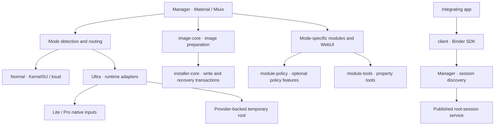

# Architecture

MapleSU is an Android root manager with two work modes. **Normal** builds on KernelSU and its module ecosystem. **Ultra** prepares a kernel patch for the device's own kernel and grants SU through a dedicated runtime. The Manager separates UI, mode detection and routing, image preparation, installation transactions, root sessions and mode backends. Material and Miuix share one orchestration layer, and backend probes and operation results decide which capabilities are available.

This page is the map. The guides in the [documentation index](README.md) go deeper. `python tools/check_architecture.py` checks the rules stated here, so the map and the code cannot drift apart unnoticed.

## At a glance

## Repository map

| Path | Role | Origin |
| --- | --- | --- |
| `manager/` | The Android app: UI, mode detection, authorization, installation, modules, themes and catalogs | MapleSU, built on the 7kimisu manager; see [Origin of the code](#origin-of-the-code) |
| `client/` | `CooperativeSuClient`, session objects and the shared Binder AIDL; an independently buildable AAR that carries no backend SDK or root credentials | MapleSU |
| `consumer/` | Example app that runs in its own UID | MapleSU |
| `image-core/` | Boot and vendor_boot inspection, compression, rebuilding and AVB handling; plain Java | MapleSU; format references are recorded in `third_party/DEPENDENCIES.md` |
| `installer-core/` | File and block-device writes, multi-partition plans, journals and recovery; plain Java | MapleSU |
| `runtime/` | Native SU execution, supervised sessions, JNI and the Ultra SDK adapters | MapleSU adapters in `runtime/src` and `runtime/ultra`, over pinned inputs in `runtime/upstream` and `runtime/upstream-pro` |
| `patch-engine/` | Native kernel analysis and the Lite patch-plan path, with per-kernel release assets | MapleSU, over a pinned patch core in `patch-engine/upstream` |
| `native-inputs/` | Retained kernel Images, symbols, policy payloads, BTF, configurations and compatibility contracts | Fixed inputs indexed in `release/native-inputs.json` |
| `jailbreak-providers/` | Temporary-root providers, authenticated leases and kernel adaptation contracts | Per provider; each records its own source and artifacts |
| `module-policy/` | Module policy parsing, loading and optional backend preparation | MapleSU, over pinned Magisk and libsepol sources that keep their licenses |
| `module-tools/` | Multicall property-tool entry point | MapleSU entry point over the pinned tree in `third_party/ksu_props` and a Cargo lockfile |
| `third_party/` | Upstream source records, pinned inputs, integration patches and notices | Third party; see [Third-party boundary](#third-party-boundary) |
| `tools/` | Repository-wide entry points: host checks, native-input preparation, generators, device checks and the release audit; the [README](../tools/README.md) indexes them | MapleSU |
| `scripts/` | The Ultra backend's build, SDK-identity and regression toolchain; regression tests live in `scripts/tests/`, and part of the toolchain is pinned by the SDK record, see the [README](../scripts/README.md) | MapleSU |
| `release/` | The public-source policy `release/source-policy.json`, read by `tools/release_audit.py` | MapleSU |
| `docs/` | Guides; start from [the index](README.md) | MapleSU |
| `gradle/` | Version catalog, dependency verification metadata and the wrapper | n/a |
| `.github/` | Workflows, issue templates and the pull-request template | MapleSU |
| `maplesu-module-market/`, `maplesu-theme-market/`, `zygisk/` | Module and theme catalog workspaces and the Zygisk adapter: independent repositories with their own maintainer records | Catalog authors; see [Community repositories](#community-repositories) |
| `.deps/` | Retained SELinux/libsepol source snapshot used by the policy-tool build | Pinned component source with its original notices |
| `.analysis/`, `evidence/`, `work/` | Local research and candidate outputs, excluded from the source export | Development records; build inputs live in the retained source directories |

## Gradle modules and dependency rules

| Module | Directory | May depend on |
| --- | --- | --- |
| `:manager` | `manager/` | `:image-core`, `:installer-core`, `:libsu-service` |
| `:image-core` | `image-core/` | Nothing; JDK only |
| `:installer-core` | `installer-core/` | Nothing; JDK only |
| `:maplesu-client` | `client/` | Nothing |
| `:maplesu-consumer` | `consumer/` | `:maplesu-client` |
| `:libsu-service` | `third_party/libsu-service/` | Nothing; pinned Apache-2.0 source |

`python tools/check_architecture.py` enforces these rules. A rule that fails on a change you intend to make is updated in the same commit as this page.

| Rule | What it keeps true |
| --- | --- |
| `gradle-edges` | Modules depend only on the edges in the table above |
| `pure-java-modules` | `image-core` and `installer-core` import only the JDK and their own packages, so `python tools/check_host.py` tests them with a bare JDK |
| `app-facing-modules` | `client` and `consumer` stay out of Manager internals; the three Binder interfaces in `dev.maplesu.manager.runtime` are the only shared types |
| `aidl-parity` | The Binder AIDL in `client/src/main/aidl` and `manager/src/main/aidl` stays byte-identical, because the Manager does not depend on `client` |
| `native-boundary` | Only a short list of files loads a native library or declares JNI methods; Ultra reaches its SDK only through `runtime/ultra/bridge/NativeBridge.java` |
| `third-party-records` | Every directory under `third_party/` has a source, license or manifest record, and every link in `third_party/DEPENDENCIES.md` resolves; directories without a license text are listed as notes |
| `docs-paths`, `docs-index` | Paths named on this page exist, every top-level directory is described here, and every guide in `docs/` is reachable from the index |
| `directory-readmes` | Every top-level directory, except build plumbing and the retained inputs, has a README that says what lives there and how to build and test it, and its local links resolve |
| `script-layout` | Regression tests live in `scripts/tests/`, and a script that finds the repository root from `__file__` uses the index its depth requires, so moving a file cannot silently point it elsewhere |
| `pinned-scripts` | Explicit WIP checkpoints verify current scripts by path, size and SHA-256 in `release/native-inputs.json`, and retain the recorded SDK input bytes. Other scopes keep the SDK-record digest checks. Formal artifact and runtime acceptance remain separate |
| `portable-paths` | No first-party file hard-codes a maintainer's workspace, user profile, pinned JDK or Python directory, or device serial; tools are found through the environment variables in the [build guide](BUILD.md#locating-tools). Retained inputs, receipts and pinned upstream trees keep the paths they were recorded with |

The Normal backend has its own machine-checked boundary: `manager/src/ksu/java` holds the KernelSU JNI backend, and `manager/src/test/java/dev/maplesu/manager/ksu/KsuSourceIsolationTest.kt` checks which files may sit beside it and which imports may reach it.

## The Manager

### Source roots

`:manager` compiles several source roots into one module:

| Root | Content |
| --- | --- |
| `manager/src/main/java` | The two Kotlin namespaces described below, plus the Java entry points for native code |
| `manager/src/ksu/java` | The Normal backend: KernelSU JNI facade, root executor and module operations |
| `jailbreak-providers/android/src/main/java` | Provider, lease and artifact code, kept in the providers tree so provider work stays reviewable |
| `jailbreak-providers/maplesu-93260/src/main/kotlin` | One provider's Kotlin sources |
| `jailbreak-providers/ghostlock/profile-core/src/main/kotlin` | Vendored byte for byte; see `jailbreak-providers/ghostlock/profile-core/vendored.json` |
| `jailbreak-providers/ghostlock/extractor/src/main/kotlin` | A host-tested JVM profile extractor |

### Two Kotlin namespaces

- `com.maplesu.core` is the application shell inherited from 7kimisu: most Compose screens and components, navigation, themes, settings and data. MapleSU modifies and extends it.

  The manager's namespace, AIDL and JNI profile lookups use `com.maplesu.core`; its installed package stays `dev.maplesu.manager`. Legacy kernel data paths, external manager package names and foreign ramdisk markers keep their original values so upgrades and migration detection continue to work.
- `dev.maplesu.manager` holds MapleSU's domain packages and its work-mode screens.

Imports run in both directions today, so treat the split as origin, not as layering.

### Packages in `dev.maplesu.manager`

| Package | Responsibility | Start reading at |
| --- | --- | --- |
| `workmode/` | Mode model, detection, routing and switching; per-mode settings storage; snapshots; work-mode screens | `workmode/detect/DetectionRules.kt`, `workmode/switch/ModeSwitchPreflight.kt`, `workmode/storage/ModePaths.kt` |
| `runtime/` | Native SU execution, supervised sessions, the credential store and app authorization; `runtime/ultra/` is the Ultra Pro adapter | `runtime/NativeSu.kt`, `runtime/MapleSuCredentialStore.kt`, `runtime/ultra/UltraRuntimeClient.kt` |
| `installer/` | Root-side installer service, block-device access, baseline provisioning, stock backup resolution | `installer/BlockPartitionAccess.kt` |
| `modules/` | Module routing, archive inspection and compatibility records | `modules/ModuleModeRouter.kt`, `modules/compat/UltraModuleCompatibilityRegistry.kt` |
| `ultrakernel/` | Ultra kernel preparation | `ultrakernel/UltraKernelFlow.kt`, `ultrakernel/KernelSeries.kt` |
| `patching/` | The Lite boot patcher | `patching/LiteBootPatcher.kt` |
| `jailbreak/` | Temporary-root provider orchestration | `jailbreak/JailbreakExecutor.kt` |
| `liteweb/` | Lite web manager: an HTTP admin served by a root service or a standalone daemon | `liteweb/LiteWebAdminController.kt` |
| `recovery/` | Boot-time recovery hooks shared by Pro and KSU modules | `recovery/BootHookModule.kt` |
| `market/` | Signed-catalog client for the module market | `market/MapleMarketRepository.kt` |
| `ksu/` | Glue between the app and the Normal backend in `manager/src/ksu/java` | `ksu/KsuRootChannel.kt` |

The smaller packages (`soter/`, `litehidden/`, `parasite/`, `pro/`) are described by their own sources.

### Where new code goes

- **Domain logic and orchestration** goes in `dev.maplesu.manager`. If it needs no Android API and no Manager state, put it in `image-core` or `installer-core`, where `python tools/check_host.py` can test it on a bare JDK.
- **Native calls** extend an existing site: `manager/src/ksu/java` for Normal, `runtime/ultra/bridge/NativeBridge.java` for the Ultra SDK, and the runtime JNI for SU execution. Do not add a library loader elsewhere; `native-boundary` fails if you do.
- **App-facing API** goes in `client/`. Mirror any AIDL change in `manager/src/main/aidl`; `aidl-parity` fails otherwise.
- **Screens** follow the screen they extend in `com.maplesu.core.ui`, or the work-mode screens in `workmode/`. Add Material and Miuix variants together, with English default strings and Simplified Chinese strings.
- **Third-party code** never gets copied into first-party packages. Add a pinned input with a record under `third_party/` and reach it through an existing adapter.
- **Scripts and tools.** A repository-wide entry point or generator goes in `tools/` and gets a line in its README. Build, identity and regression work for the Ultra backend goes in `scripts/`, with tests in `scripts/tests/`. Update current source input records when changing a pinned tool in a WIP checkpoint; preserve historical SDK receipts. Other scopes must keep the SDK-record digest contract. The pinned list is in `tools/check_architecture.py`.
- **A new top-level directory** gets its own `README.md`, a row in the repository map above, and, if it is a Gradle module, a row in the module table.

## Core flows

### Modes and runtime readiness

There are two product modes: **Normal** and **Ultra**. The internal `WorkMode.KSU` and `WorkMode.LITE` names are stable storage and protocol values. Lite and Pro identify Ultra backend variants, not additional product modes.

`workmode/detect/DetectionRules.kt` combines kernel responses, Manager ownership, runtime handshakes, current-boot evidence and persisted state. Mode classification, backend readiness and usable root sessions are separate results. Module and execution routers require an identified, available backend before dispatching work.

Mode settings use separate stores. A switch runs through preflight, snapshots, candidate preparation, journaled installation and post-boot verification. The switch controller retains an operation identity and recovery state across interruptions. Selecting a mode in the UI is only the beginning of that process.

### Normal

Normal integrates the KernelSU kernel implementation, its superuser interfaces and the `ksud` module lifecycle. `workmode/backend/KsuBackendRegistry.kt` connects the mode to narrow execution, module and settings interfaces, and the UI consumes those interfaces.

The installer selects a packaged LKM by KMI and prepares the boot-image ramdisk through the KernelSU installation path. Availability depends on the actual kernel configuration, Manager ownership and the packaged artifact. KernelSU sources and MapleSU's integration patches are recorded under `third_party/kernelsu/`.

### Ultra: kernel preparation

The Ultra installation dispatcher selects `ultrakernel/UltraKernelFlow.kt`. It prepares a patch against the kernel already present in the input boot image:

1. Inspect the boot container, decode its ARM64 kernel and read the full kernel release.
2. Inspect the release assets within the matching kernel series. `ultrakernel/KernelSeries.kt` lists the series that have a render tier (5.10, 5.15, 6.1, 6.6, 6.12 and 6.18) and refuses the others. Eligible generation paths resolve symbols and render a plan against the target kernel; a declared but invalid asset remains an error.
3. Check patch locations, original bytes, relocations, credential slots and generated patch-site coverage against the target kernel.
4. Rebuild the boot image and record source, kernel and output digests. The builder produces a candidate file and a receipt.
5. Hand the candidate to the installation transaction, which independently checks and writes the target partition.

`patching/LiteBootPatcher.kt` keeps the dedicated Lite path through the native `patch-engine/`. It also validates the input, rebuilds the image and checks the resulting kernel. The image patchers never open device partitions.

### Ultra: SU and authorization

Ultra obtains SU through kernel patches and the selected native runtime. The implementation changes privilege and execution paths, including AVC-related kernel handling. The Lite path supports delivered SU clients and supervised execution; the Pro path connects kernel-backed authorization, environment management and native modules through its integrated SDK.

MapleSU maintains the authorization transactions and SDK adaptations around those components:

- Application grants and revocations are written through the selected backend. The Pro adapter reads back the authorization list before updating its displayed state.
- Pro authorization-table updates are serialized, written and read back before publishing a live pointer. Failed persistence restores the previous live pointer.
- Boot restoration refreshes the UID mapping of existing grants within the current boot and credential scope.
- `runtime/ultra/UltraRuntimeClient.kt` and `runtime/ultra/bridge/NativeBridge.java` centralize SDK calls, request context, concurrency control and structured results.

The public application SDK is a separate Binder interface. Its clients receive session handles and streams; the native backend credentials stay with the Manager and runtime.

### SELinux and environment consistency

Ultra's core design keeps SELinux Enforcing while minimizing policy changes and additional mounts. Policy data, kernel access checks and file labels are distinct parts of the design: kernel patches change access-check behavior, and helper deployment may set and verify SELinux file labels.

Module features have their own effects. Script modules can request mounts, properties and `sepolicy.rule` changes. The policy subsystem tracks the requested mode separately from the effective mode proven for the current boot:

| Policy mode | Meaning |
| --- | --- |
| Block | Blocks module policy transactions |
| Load | Allows policy loading when the required backend is ready |
| Hide | Requests loading with the backend's policy-view adaptation |

The subsystem reports requested settings alongside the active backend state. Mount helpers track their own mounts for cleanup. Module policies and mounts stay separate from the core SU path.

### Temporary-root providers

`jailbreak-providers/` supplies an additional Ultra root path for compatible targets. The provider creates a privileged process and hands it to MapleSU through an authenticated, current-boot lease. The consumer verifies peer identity and an attempt-specific nonce, then supervises command streams and process lifetime.

The provider workflow covers admission, privileged lease handover, environment restoration and daemon publication. Firmware, kernel and profile inputs and the selected provider determine the execution path. Installation and boot follow the device's partition-access, bootloader and verified-boot requirements.

### Modules and WebUI

`modules/ModuleModeRouter.kt` selects the backend for the active mode. Archive inspection validates paths, limits, metadata and native entry information before installation.

| Module path | Execution model | Compatibility boundary |
| --- | --- | --- |
| Normal KSU modules | KernelSU and `ksud` lifecycle | Kernel and module-specific requirements |
| Ultra KSU-style scripts | MapleSU's adapted script runner with ordered lifecycle hooks | Module scripts, properties, mounts and optional policy rules |
| Ultra native modules | Native descriptors and lifecycle calls through the compatible Pro SDK backend | Module ABI, SDK version, kernel interfaces and action-specific compatibility records |

Ultra supports the native module ABI documented in the retained SDK. That module ABI differs from the application Binder SDK and from Linux `.ko` modules. `modules/compat/UltraModuleCompatibilityRegistry.kt` applies module, backend and kernel compatibility records before native lifecycle operations.

WebUI routing follows the module path: KSU asset webroots, the Ultra script proxy and SDK-started native-module HTTP callbacks have separate lifecycle and readiness checks. Development instructions are in the [module guide](MODULES.md), the [Ultra native module guide](ULTRA_MODULES.md) and the [compatibility guide](MODULE_COMPATIBILITY.md).

### Application root sessions

An integrating app uses `CooperativeSuClient` from `client/` to verify the installed Manager's signing certificate and explicitly bind its discovery service. The broker returns an already published root executor. An external bind does not start elevation.

The root-side `runtime/NativeSuBinder.kt` reads `Binder.getCallingUid()` and resolves the caller's app identity. It checks authorization, prepares the child process and rechecks authorization before committing execution. The session owner is checked again on every later control call.

Standard input, output and error use file descriptors. Binder carries lifecycle control, exit status, signals, terminal resize and cancellation. Sessions supervise their processes and release resources on closure or owner death. See the [SDK guide](SDK.md) and the separate-UID [example app](../consumer/).

### Image writes and recovery

The selected installation target is independent of the active mode. `image-core` inspects and rebuilds containers, mode-specific producers create candidates, and `installer-core` and the Manager's root-side installer service perform the writes.

Direct installation first extracts the current target partition through an available root channel, then uses the candidate and transaction workflow. Transaction checks include source identity, partition and slot selection, backup state, candidate digests, synchronized writes and readback. Recovery uses the retained journal and the original data. Successful image preparation, a completed partition write and a successful post-boot runtime check are recorded separately.

Image and transaction logic runs on the host with synthetic inputs. Test commands and device procedures are in the [testing guide](TESTING.md).

### Community repositories

The module and theme catalogs are independent repositories with author and maintainer records. The module market verifies signed catalogs and checks package size and SHA-256 against the verified entry. Catalog authenticity and package integrity are separate from source, license and compatibility review.

The Zygisk adapter is delivered through the module repository, and ReZygisk is outside this repository's compilation and packaging scope. Each independent package keeps its own source, notices and validation requirements. See the [module repository guide](MODULE_REPOSITORY.md) and the [theme repository guide](THEME_REPOSITORY.md).

## Origin of the code

MapleSU's source falls into three kinds, recorded separately so the status of any file can be checked:

| Kind | What it is | Where it is recorded |
| --- | --- | --- |
| Written by MapleSU | Code with no upstream source recorded: the `dev.maplesu.*` packages, `image-core/`, `installer-core/`, `client/`, `consumer/`, the Ultra adapters and the tools | File headers and the repository history |
| Derived from a pinned upstream | Files that start from an upstream release and change in place: the 7kimisu manager base, and KernelSU with MapleSU's patch series | `third_party/7kimisu/source-manifest.json`, `third_party/kernelsu/manifest.json`; the original notices stay in the files |
| Pinned third-party input | Code and binaries MapleSU builds against and does not claim: backend inputs, vendored libraries and sources | `third_party/DEPENDENCIES.md` and each input's manifest |

For the Manager, the comparison with the pinned 7kimisu snapshot is reproducible: `python tools/check_architecture.py --report` hashes every Kotlin and Java file in `manager/src/main/java` and `manager/src/ksu/java` against the manifest. At the time of writing:

| Manager sources compared with the snapshot | Files | Lines | Share |
| --- | --- | --- | --- |
| Derived from 7kimisu, unchanged | 148 | 21,412 | 11.4% |
| Derived from 7kimisu, modified by MapleSU | 115 | 32,688 | 17.4% |
| Not in the snapshot: added by MapleSU | 709 | 134,120 | 71.3% |

The last row means MapleSU added the file to the manager. It does not assert that no other upstream contributed to it: KernelSU, FinaSU and the other recorded upstreams are tracked by their own manifests and file headers. The table counts source lines in the two roots only, not tests, resources or effort.

## Third-party boundary

Everything under `third_party/`, the pinned input directories (`patch-engine/upstream/`, `runtime/upstream/`, `runtime/upstream-pro/`, `module-policy/upstream/`) and `.deps/` is pinned input. Do not edit it by hand. Update it through the procedure in [Native dependencies](NATIVE_DEPENDENCIES.md), refresh its manifest and keep its notices. MapleSU code adapts these inputs through the adapters described above and never copies them into first-party packages.

The [dependency inventory](../third_party/DEPENDENCIES.md) is the single list of components, pinned versions and licenses. [Credits](../CREDITS.md) and [NOTICE](../NOTICE) carry the acknowledgements and notices. The complete source export retains the native inputs indexed in `release/native-inputs.json`; its archive check verifies their hashes.

### Backend inputs and maintenance

Normal uses pinned KernelSU sources and recorded patches. Ultra combines the retained patch core and native SDK with MapleSU authorization transactions, runtime adapters, policy backend and module workflows. Component origins are recorded in [Credits](../CREDITS.md).

Backend updates must pin the source or prebuilt input, verify its provenance and distribution conditions, rebuild paired components where required, and validate authorization, environment setup, modules and recovery together. Candidate CMake targets marked `EXCLUDE_FROM_ALL` stay distinct from the packaged backend selected by its manifest. A source change alone does not show that the packaged backend was rebuilt.

The client AAR, the host libraries and the consumer example build separately. A complete Manager build also needs the fixed native inputs. Build checks, package identity checks and device acceptance are separate release requirements; see the [build guide](BUILD.md), [native dependencies](NATIVE_DEPENDENCIES.md), [testing guide](TESTING.md) and [release process](RELEASING.md).

### Replacing a backend input

The SDK is reached only through `runtime/ultra/UltraRuntimeClient.kt`, `runtime/ultra/bridge/NativeBridge.java` and the runtime JNI, and `native-boundary` keeps it that way. A replacement therefore has a bounded contract: the JNI surface of `NativeBridge.java` and the module ABI in the [Ultra native module guide](ULTRA_MODULES.md). Build the replacement against that contract, record its provenance in its own directory or under `third_party/`, and do not copy code from inputs whose terms are not recorded.

## Changing things safely

1. Run `python tools/check_architecture.py` and `python tools/check_host.py`, plus the Gradle unit tests described in the [testing guide](TESTING.md).
2. When you add a Gradle module, a top-level directory, a native-loading site or a guide in `docs/`, update the rule and this page in the same commit. The checker fails otherwise.
3. When you add or update a retained build input, follow "Keep the checkout portable" in the [development guide](DEVELOPMENT.md).
4. When you bring in third-party code, record the repository, pinned version, license, modification scope and required source, as [CONTRIBUTING](../CONTRIBUTING.md) asks.
