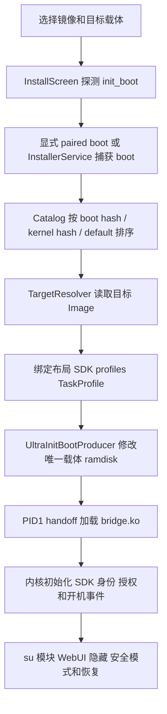

# Ultra 单文件 init_boot、KMI 选型与 5.10–6.18 开发评估

公开快照约定：`WORKSPACE` 为源码工作区占位，`WORKSPACE_BUILD_PRESERVE` 为独立构建证据目录占位，`SERIAL` 为测试设备序列号占位；私有证据按原路径后缀定位。

日期：2026-11-24 UTC。范围：固定 KernelSU 源码、当前 Ultra 生产调用链、工作区原始 init_boot、原需求和本代构建收据。本文是开发评估与实施验收合同；源码审查、主机测试、正式产物、设备效果分别记账。

## 1. 评估结论

**在对应组件和运行时适配覆盖的设备上，技术路线可行：Ultra 可以按 KMI 选择自有预编译内核桥，只处理一个 init_boot 文件，并在启动时由原厂内核加载桥、接入现有 SDK 与全部功能。当前工作树尚未交付这条完整产品路径。**

| 用户要确认的事项 | 当前证据支持的结论 |
|---|---|
| 像 KSU 一样按 KMI 选组件 | 可实施。固定 KSU 已有真实实现；Ultra 有组件、loader、动态布局和符号解析基础，但 catalog 尚未按 KMI 索引，部分目标事实仍在修补阶段由整份 boot 提供。 |
| 只修补、只写 init_boot | 当前 producer 已有仅改 ramdisk 载体的源码路线，目标 boot 只读。新一代完整设备验收尚未完成。 |
| 无 Root、离线仅选择一个 init_boot 修补 | 当前入口仍依赖 paired boot / InstallerService 或事先绑定目标的 artifact，与原要求存在差距。KMI 选型加启动时真实适配闭合后可消除该依赖。 |
| 仅 init_boot 实现 Ultra 全部既有功能 | 原需求明确要求；内核桥设计允许实现，但当前单文件路径、全部启动消费者与同代设备回归尚未闭合。桥编译、容器回包、一次 UID=0 均不单独证明全部功能。 |
| 已完整支持 5.10–6.18 | 尚未达到逐 KMI、厂商、配置、页大小及必要设备的完整支持验收。范围目标继续保留，具体缺口见第 7 节。 |
| 所有 init_boot 都可正确识别和修补 | 当前工作区样本的格式能力与完整生产修补分开评估；六份内容唯一的 init_boot 不构成所有厂商、历史修补格式及配置的普遍证明。 |
| 稳定性与 KSU 一致 | 当前缺少同设备、同原厂内核、相同操作与负载的成对数据，尚不足以作该承诺。第 10 节给出可执行比较方式。 |

“单文件”指用户只提供待修改的 init_boot 镜像；APK 内预置组件、当前设备自动识别出的 KMI，或离线明确选择的 KMI 属于组件选型信息，不是第二份配对镜像。脱离设备环境且没有目标 KMI 信息的纯 ramdisk 文件，本身不携带完整内核身份；允许用户选择适用 KMI，或由启动端从活体内核取得实际事实，符合 KSU 的实际思路。

“仅写 init_boot”还须区分新安装和从旧 boot 载体迁移：新独立安装应保持原厂 boot 字节不变；旧 boot 已有本产品补丁时，迁移需要先按真实可恢复记录去掉旧载荷。这时恢复 boot 是迁移写集合的一部分，不是额外给 init_boot 再打一次 boot 补丁。

## 2. 原需求重新核对

权威来源是 [SDK-REFACTOR-REQUIREMENTS.md](SDK-REFACTOR-REQUIREMENTS.md)，历史状态栏只保留原证据范围，不作为本代通过。

| 原要求 | 原文位置 | 本次判断 |
|---|---:|---|
| 保留 Ultra SDK、原生模块、全部既有功能，不切换成另一后端 | 303 | 使用 MapleSU 自有 bridge 与 SDK；KSU 是实现和行为参照。 |
| 布局来自实际目标 BTF / 访问器 / 只读验证，版本不用于猜偏移 | 306、365 | KMI 可以选编译组件；正常 loader ABI 与本地对象可由经验证的构建合同承担，目标动态字段仍按 BTF / 访问器 / 只读验证取得，目标指令字节必须取自实际目标。 |
| 文件修补不依赖 Root、安装事务、已装环境或页面预检 | 307、377，CASE-06a:468 | 当前 init_boot 的 paired / 服务入口门与此不符，需要移入真实执行链并消除多余依赖。 |
| 独立内核桥有可维护源码、符号版本 / CFI 合同；原厂 boot 不变，仅写 init_boot | IMG-08:378 | ABI 正确性本就是原要求；用户另交 boot、BTF、源码或资格材料并非该要求的必然推论。 |
| boot/init_boot 贯穿文件修补、直接安装、切换、升级、备份恢复 | IMG-09:379、IMG-10:381 | 选择载体与选择内核组件分开，恢复使用真实来源与最小写集合。 |
| 去不必要 Key、手工配对、重复注入、依赖打开 Manager 才启动 | TRUST-02:411 | 组件安装与启动适配在 early init / 内核端完成，不交给 Manager 补启动。 |
| init_boot 与 boot 的全部功能等价 | 582–587，尤其 584 | 要覆盖标准 su、持久授权、隐藏、SELinux、两类模块全部开机阶段、升级、切换、卸载还原。 |
| 原 20 组问题及追加体验、SDK 性能问题 | 463–491 及本次会话 | 完整保留；本轮进行需求映射和镜像链深审，未把它们全部重新实测为通过。 |

当前执行账保留 20 组、29 个原子 CASE 与 12 个追加项，共 41 项。逐原子项的本轮覆盖记录见 `CASES.md`（开发证据未随公开快照分发：`WORKSPACE/.tmp/supervision-20261123-build-acceptance/source-repairs-current/kmi-requirements-reanalysis-20261124-r1/requirements/CASES.md`）。其余 119 项总需求也未被此专项缩减。

## 3. 固定 KSU 的真实修补和启动环节

参照提交：`f4603d14bd7f3bf21206d6f7c622ddf1c049ade3`。27 份选定文件从 `.research/KernelSU` 的不可变 git 对象导出，并核对上游记录 SHA；没有把可变 upstream / applied 工作树混称未修改的官方基线。

以下 KSU 路径相对证据目录的 `ksu/fixed-baseline/`，精确行号与身份见 `固定基线分析`（开发证据未随公开快照分发：`WORKSPACE/.tmp/supervision-20261123-build-acceptance/source-repairs-current/kmi-requirements-reanalysis-20261124-r1/ksu/ANALYSIS.md`） 和 `模块运行时补充`（开发证据未随公开快照分发：`WORKSPACE/.tmp/supervision-20261123-build-acceptance/source-repairs-current/kmi-requirements-reanalysis-20261124-r1/ksu/BTF-MODULE-SUPPLEMENT.md`）。

| 环节 | 固定 KSU 实际行为 | 对 Ultra 的含义 |
|---|---|---|
| 取得 KMI | `boot_patch.rs:686–727` 接受显式 KMI；Android 普通路径可读 uname、回退 vendor 模块 vermagic；主机可读含 kernel 的输入。显式 module 可跳过自动 KMI。 | 离线 init_boot 可用明确 KMI / 组件，不应强制 paired boot。跨设备文件不得把当前设备内核身份当成所选目标的事实。 |
| 选择组件 | `773–790` 按 `{kmi}_kernelsu.ko` 精确资源名取预编译模块，主机另带架构路径；没有按最近小版本猜选。 | 以 KMI 索引自有 bridge；实际打包了哪些组件，才列哪些可选项。 |
| 选择载体 | `223–245` 按实际分区、显式参数、是否替换 kernel、android12 分支决定 boot 或 init_boot。 | 5.10–6.18 是内核范围，不代表每台设备都有 init_boot。保留真实 boot 路线。 |
| 修改 CPIO | `808–830` 保留原 init，写 ksuinit 与 kernelsu.ko；`897–905` 重建 ramdisk 与容器。 | 单 init_boot 可以装入具有内核能力的模块；仅加用户态 helper 尚不等于 Ultra 已生效。 |
| 是否替换 kernel | 仅显式 `--kernel` 时，`767–770` 调用 replace_kernel。 | LKM 路线不需要替换原厂 kernel。 |
| 早期启动 | ksuinit 在 PID1 阶段读 ramdisk 模块并加载，再交给原 init。 | Ultra 已有相似 handoff；必须同时保证原 init 交接和真实内核回执。 |
| 符号与 vermagic | `ksuinit/lib.rs:344–451` 从活体 kallsyms 绑定符号；普通 init_module，识别特定 vermagic 错误后改 modinfo 重试一次。 | 目标地址可启动时取得。该机制不意味着任意函数类型、对象布局或 CFI 都自动适配。 |
| CRC 构建合同 | `kernel/tools/check_symbol.c:126–154` 要求存在空 `__versions`；loader 自身不改 CRC 表。 | 不应把 Ultra 的逐导入 CRC 前检误称 KSU 同样要求，也不应直接清空 Ultra 表就宣布兼容。实际组件构建和 kernel loader 行为须另验。 |
| 模块自身适配 | 运行时 BTF 查两个 LSM blob 字段；解析 CFI 符号变体与实际 LSM 表。 | KSU 的单文件能力也依靠启动后的真实内核适配，并非 init_boot 自带内核信息。 |

固定基线的资源 basename 是 `androidXX-X.Y`，会丢弃 sublevel 和 KMI generation。其文档完整 KMI 形式则是 `X.Y-androidXX-generation`。例如 `android15-6.6` 是资源选择键，不等于所有完整 KMI / 厂商配置均已被证明兼容。

KSU 的 runtime BTF 路径也有真实失败语义：`MODULE && CONFIG_DEBUG_INFO_BTF` 下，必要 inode 字段解析失败会让模块初始化返回错误；另一编译条件使用编译时 helper。它不是任意内核上永远成功的通用适配器。稳定性比较应使用 KSU 实际支持的组合和实际结果。

## 4. Ultra 当前真实调用链与差距



1. [InstallScreen.kt:716](../manager/src/main/java/com/maplesu/core/ui/screen/install/InstallScreen.kt) 在选择 init_boot 后，若未提供 paired URI，会调用 InstallerService 观察和捕获当前 boot；320–325 行将准备未完成转为 bridge blocker。离线无服务用户尚未到实际文件修补就会被挡住。
2. [KsuCli.kt:1145](../manager/src/main/java/com/maplesu/core/ui/util/KsuCli.kt) 的真实执行链也保留 paired snapshot / URI / 显式 artifact 依赖；单删 UI blocker 后，生成器仍可能缺目标事实。
3. [UltraInitBootCatalog.kt:67](../manager/src/main/java/dev/maplesu/manager/ultrakernel/UltraInitBootCatalog.kt) 按完整 boot SHA、kernel SHA、default 排候选并逐项调用 resolver。它不是纯 hash 白名单，但也不是 KMI 优先选择器。哈希用于内容身份和已知候选快路合理，不应据此宣称未知 hash 必然不兼容。
4. [UltraInitBootTargetResolver.kt:116](../manager/src/main/java/dev/maplesu/manager/ultrakernel/UltraInitBootTargetResolver.kt) 取得 Image/config/symbols，现代分支核 localTypes、函数原型和 BTF，绑定 runtime/SDK/profiles；有 TaskProfile 时仍生成目标 proof。
5. 同文件 294–349 的 `same-kmi-module-loader` 仅对 legacy 路线开放，`kernelSeries` 只解析 X.Y；它仍有目标 Image 和 TaskProfile 消费，不是完整 KMI 无配对安装链。非 loader 分支的硬 BTF 要求也不等于所有路线普遍要求 BTF。
6. [UltraInitBootArtifact.java:125](../image-core/src/main/java/dev/maplesu/image/UltraInitBootArtifact.java) 和 Artifact 数据模型仍要求 targetBoot、kernel hash/release，并反读非空 kernel。要支持纯单文件组件路线，数据合同也需要拆开；用一个虚构 boot 或参考内核冒充目标会产生错误事实。
7. [UltraInitRamdisk.java:30](../image-core/src/main/java/dev/maplesu/image/UltraInitRamdisk.java) 已能保留原 init、安装自有 handoff 与 bridge、核非目标条目不变。输出载体可以是 init_boot，并非必须给 boot 再打补丁。
8. [handoff.c:115](../runtime/ultra/boot/ultra-init/handoff.c) 在 PID1 加载桥，保持原 init 交接；[bridge.c:89](../runtime/ultra/boot/init-bridge/bridge.c) 在启动入口先检查动态 layout ready。现有 runtime lookup 会解析函数，不负责生产所有 layout、SDK 表和 TaskProfile。

直接安装时，[StockInstallFlow.kt:52](../manager/src/main/java/dev/maplesu/manager/installer/StockInstallFlow.kt) 自动读取本次任务最终 boot 来源，属于当前内部事实获取。它不要求用户选第二份文件，也不等于写 boot；但它仍增加当前实现的读取和准备成本。离线产品入口不应继承这个服务依赖。

## 5. 必须修正的根源与实现边界

| 发现 | 影响 | 根源修正 |
|---|---|---|
| 页面、执行链和 artifact 均耦合 paired boot | 无 Root 单 init_boot 操作被提前阻断，重复读取和解析带来等待 | KMI 组件选择和目标事实生产分开；文件执行只接用户选定载体及可用组件，不访问 Root 服务来取得“可开始修补”资格。 |
| 以整目标 Image 预先生产大量私有事实 | 单纯新增 KMI UI 后仍缺字段，或错误沿用参考内核 | 逐消费者把必要事实移到运行内核生产，或由已证明稳定的组件构建 ABI 承担；保留真实失败。 |
| 全 localTypes 形状、全 TaskProfile 离线 proof 是当前策略 | 可能把更强离线证明变成所有安装的入口条件 | 核真实访问字段、对象 size/alignment、调用类型、实际 work bit；不要求用户提供整份资格资料。事实应在首次使用前有效发布。 |
| 只有函数 lookup，没有完整 runtime layout producer | 删 resolver gate 后，模块会读到未绑定或错误参考表 | 增加真实生产与 ready/bound 发布顺序，先生产再消费；失败清理和回执沿既有错误链返回。 |
| 镜像内恢复记录保留原压缩 ramdisk | 新 CPIO、组件与旧压缩 ramdisk 同时占空间，8 MiB 预算比普通只换 ramdisk 更紧 | 以实际 writer 计算完整布局；控制发布组件体积，评估保全恢复能力的最小记录，禁止简单去掉恢复或侵占 AVB。是否触发本代容量失败仍需实际候选证明。 |
| 本代 modern 封包首错为未导出 secctx 函数 | 严格 Kbuild 成功，但 package 返回 1 | typed runtime lookup 已有窄修复；Python/C direct marker 与 Manager 消费端须同步。该首错保留，不冒称用户旧 APK 的全部准备失败根因。 |
| Kotlin direct V2 表少一项（本轮已修） | 修前新增 `security_secctx_to_secid` marker 会被 Manager 报 `ULTRA_INIT_LEGACY_DIRECT_MARKER` | 已精确同步该项；真实生产 parser 代码块修前复现两项拒绝，修后同一批 ELF 字节 14/14 通过。排序、别名、符号、重定位等检查保留；完整 Manager resolve 和设备仍待验。 |

布局正确性、CFI、符号和 loader ABI 确实需要成立；这不等于要求每张镜像修补前都由用户交齐 boot、BTF、Symvers、源码、Root 或已装 Manager 环境。当前架构的成本应由组件与启动实现消化。

## 6. 工作区 init_boot 实物评估

本次范围为 `WORKSPACE/Boot_Research` 原始语料中的七个路径、六个内容唯一的 init_boot，不包含 `.tmp` 历史生成件，也不外推全盘。本次已逐图重读头部、核 SHA，并在内存解压和解析 CPIO：六份文件长度均为 8 MiB、Android boot header v4、kernelSize=0、LZ4 legacy ramdisk；此处不是设备实际分区容量测量。

| 原始路径（相对 Boot_Research） | SHA256 前 12 位 | ramdisk 字节 | 解压 CPIO 字节 / 条目数 | 保留当前恢复 / AVB 时新压缩 ramdisk 上限 | 现有目标 kernel 证据 |
|---|---|---:|---:|---:|---|
| `ACE5U/New/init_boot.img` | `6c66bd9b3f08` | 3,071,463 | 5,871,872 / 28 | 5,292,032 | 已有对应 boot 内容绑定 |
| `init_boot/ACE5U/init_boot.img` | `ed6af91fb3f0` | 3,269,960 | 6,178,304 / 28 | 5,095,424 | 已有对应 boot 内容绑定 |
| `init_boot/ACE5/init_boot.img` | `bce72796f5b0` | 2,389,641 | 4,533,760 / 21 | 5,976,064 | 本次既有配对审计范围未有匹配 boot |
| `init_boot/ACE7/init_boot.img` | `d3f0752c3d3c` | 2,870,042 | 5,396,992 / 29 | 5,496,832 | 同上 |
| `init_boot/init_boot.img` | `bb7b9c6bc2ca` | 2,870,027 | 5,396,992 / 29 | 5,496,832 | 同上；`init_boot/Oneplus16/init_boot.img` 为同内容别名 |
| `init_boot/K80/init_boot.img` | `87e1f3616f4f` | 2,307,769 | 4,407,808 / 17 | 6,057,984 | 本次既有配对审计范围未有匹配 boot |

这四组未有配对证据，只说明现有 Image 资格路径缺输入；不说明它们的 init_boot 容器不可处理，更不应升级为正常用户必须另找 boot 的产品要求。

六份 `/init` 全部是 regular、0750、uid/gid=0 的 ELF64 little-endian AArch64 ET_EXEC，未有 PT_INTERP / PT_DYNAMIC；不是符号链接。CPIO 均有完整 trailer，尾部未见非零垃圾。按条目名未见 KSU / Magisk / MapleSU / Ultra 已知补丁标记；这不是 OEM 原厂来源证明。它们符合当前 handoff 保留原 init 再装桥的基本内容条件。

六份 `/init` 均唯一；除 K80 外的五组 CPIO 中，`dev` 目录条目各出现两次。这类重复目录不应直接当损坏输入，修补时保留非目标条目及顺序；与重复 `/init` 或自有路径冲突分别处理。

六份都有 AVB footer，vbmeta 832 B、algorithmType=0、bootSignatureSize=0，头部与 footer 边界有效；这不是 OEM 验签或实际可启动证明。不得把原图 Android OS version / fingerprint 当成 kernel KMI。

已有主机证据对六份仅确认容器解析、同 ramdisk 重建和回读；`currentPositiveLifecycleAcceptance=false`，没有本代自有 bridge 部署和完整启动结果。本次解压与内容核查未生成新候选。完整逐条目 metadata、SHA 和旧收据绑定见 `SAMPLES.json`（开发证据未随公开快照分发：`WORKSPACE/.tmp/supervision-20261123-build-acceptance/source-repairs-current/kmi-requirements-reanalysis-20261124-r1/init-boot-samples/SAMPLES.json`）。

8 MiB 是供应文件长度，不是可直接使用的全部 ramdisk 空间，也不替代设备分区容量回执。本代失败封包运行留下的 bridge 为 5,084,800 B、handoff 为 3,239,608 B，均只是该次编译输出；它们的原始和为 8,324,408 B，接近 8 MiB，但实际载体放入的是含原 init 的重新压缩 CPIO，不应以该原始和断定装不下。

还发现一个额外容量成本：[UltraInitBootProducer.java:211](../image-core/src/main/java/dev/maplesu/image/UltraInitBootProducer.java) 会捕获 snapshot，337–350 行把原压缩 ramdisk 整份放进镜像内恢复记录，而非仅保存少量差异。记录内层大小为 `64 + snapshotBytes + originalRamdiskBytes + 32`，writer 另有 56 B 恢复区域头及对齐。因此 2.31–3.27 MB 的原压缩 ramdisk 除在新 CPIO 保留原 init 外，还作为恢复数据再次占空间。

容量必须同时核 `新压缩 CPIO + 原压缩 ramdisk + snapshot + 内外恢复头 + 对齐 + vbmeta/footer`。当前六图 footer 都存在，[BootImageRebuilder.java:660](../image-core/src/main/java/dev/maplesu/image/BootImageRebuilder.java) 会在恢复区后的布局侵占原文件 vbmeta/footer 空间时报 `AVB_PARTITION_SIZE_LIMIT`，不直接扩成更大的可刷文件。原图头部 4096 B 是容器页，不证明运行 kernel 的页大小。

按当前 snapshot 编码及实际 gap 分块算法逐图核算，`init_boot/ACE5U/init_boot.img` 的 snapshot 为 11,416 B，其余五图为 12,768 B；内外恢复区域合计 `Q = 原压缩 ramdisk + snapshotBytes + 152`。令新压缩 ramdisk 长度为 `R`，该批 kernel=0 / v4 的组件末尾为 `C = 4096 + align4096(R)`，恢复后为 `P = align4096(C + Q)`；最终须满足 `align4096(P) + 832 <= 8388608 - 64`。上表的新 ramdisk 上限由此得出，范围为 5,095,424–6,057,984 B。它是本批保留当前恢复记录与 AVB 布局的容量边界，不是正式组件压缩后已经达标的结果。公式及每图输入见 `CAPACITY.json`（开发证据未随公开快照分发：`WORKSPACE/.tmp/supervision-20261123-build-acceptance/source-repairs-current/kmi-requirements-reanalysis-20261124-r1/init-boot-samples/CAPACITY.json`）。

正式容量验收须用最终同代、实际发布组件逐图生成候选，再记录压缩后长度、全部恢复区和签名区域。当前这一步仍待执行；原 ramdisk 只有 2–3 MiB 以及历史同 ramdisk 回包通过均不证明装入本代组件后仍适配 8 MiB。

“所有 init_boot”至少应分开：原厂有效输入、本产品重复修补与升级输入、已知可识别的其他管理器格式、未知修改、截断 / 错误输入。正确处理包括可证明的修补或恢复，也包括损坏和未知格式的准确失败与原图保全；不把未知第三方内容直接覆盖后称为自愈成功。

## 7. 5.10–6.18 覆盖判断

固定 KSU 构建矩阵有八个资源 basename。Ultra 需按真实编译组件、配置与运行能力逐格交付，不以只扩大 series 名单替代。

| 内核系列 | 固定 KSU basename | Ultra 本代可确认的构建证据 | 单文件 init_boot / 全功能状态 |
|---|---|---|---|
| 5.10 | android12-5.10、android13-5.10 | formal510 步骤 exit 0；后续资格、封包和目录完整链未执行完 | 待完整组件、单文件与设备验收；android12 分支及无 init_boot 设备保留 boot 路线 |
| 5.15 | android13-5.15、android14-5.15 | 本轮执行在 modern 首错停止，后续 legacy515 未执行 | 待本代构建、单文件与设备验收 |
| 6.1 | android14-6.1 | raw4 对应 claim 构建 exit 0 | raw claim 不是逐 KMI init_bridge 产品支持证明；待模块路径和设备 |
| 6.6 | android15-6.6 | raw4 exit 0；modern 严格 Kbuild / handoff / ABI 步骤 exit 0，package exit 1 | 确定封包首错已定位；新修复尚未重建，单文件与设备待验 |
| 6.12 | android16-6.12 | raw4 对应 claim 构建 exit 0 | 待完整 init_bridge 对应组件、单文件和必要设备 |
| 6.18 | android17-6.18 | raw4 对应 claim 构建 exit 0 | 待完整 init_bridge 对应组件、真实目标样本和必要设备 |

该表描述现有收据，不把 claim 产物与可启动 bridge.ko 混为一物。证据：`NATIVE-EXECUTION.json`（开发证据未随公开快照分发：`WORKSPACE/.tmp/supervision-20261123-build-acceptance/source-repairs-current/root-build-20261124-r6/NATIVE-EXECUTION.json`）、`modern EXECUTION.json`（开发记录：`WORKSPACE_BUILD_PRESERVE/20261124/bridge-current-r2/EXECUTION.json`）。

目标边界继续包括真实 BTF / 无 BTF、4K / 16K / 64K、CFI 变体、厂商模块与实际 loader 条件。32 位应用兼容和 32 位内核支持分账。NGKI、no-modversions 及另行提出的 Linux 4.x 评估保留独立状态，不由上述 GKI basename 自动覆盖。

还有几个与容器识别不同的实际边界：设备没有 init_boot 时使用 boot；内核未启用模块加载、要求但未接受所选模块签名、缺必需符号或存在未适配 ABI / CFI 时，LKM 路线可能加载失败。KSU 的容器修补也不消除这些条件。产品应在实际执行 / 启动记录具体结果，选择确证适用的既有路线，不偷偷套邻近 KMI 或把未生效记为成功。

## 8. 推荐开发方案

### 8.1 组件选择与载体选择分开

按 KSU 的资源粒度建立实际可用的 `androidXX-X.Y` 索引，保留完整 release / generation 与架构作为诊断和适用范围资料。确有页大小、CFI 或其他构建 ABI 变体时在组件内部选路，避免把未证明稳定的私有差异塞进一个粗 KMI 字符串。

本机直接安装从运行内核取得 KMI；含 kernel 的离线 boot 以目标文件为准；无 kernel 的离线 init_boot 使用明确选择的 KMI / 组件。本机自动值可以作为默认，但应有修改目标的入口，避免替另一台设备修补时静默套用当前设备 KMI。Android 系统版本、机型名、init_boot 文件名及 AVB fingerprint 不替代 kernel KMI。

保留 hash 作为实际内容身份、缓存约束和已有目标快路，兼容性依据为组件合同与实际适配结果。凭据、签名身份、部署命名空间与 KMI 缓存分别绑定。

### 8.2 单文件 producer 的最小合同

将“可复用组件包”与“本次实际目标事实”从当前 Artifact 拆开；只做为满足这条链所需的修改，不另建泛化框架。

- 单文件执行输入：用户选择的 init_boot、所选自有组件、必要签名参数与本次部署资料。
- 执行内部依次完成容器解析、已知旧载荷处理、CPIO 生成、压缩和重建、候选回读、原图与输出身份记录。必要时恢复已知原件，不叠加旧载荷。
- 正常文件修补不启动 Root / InstallerService，不读取活分区，不依赖旧事务、已装环境或 Manager 就绪。底层错误在本次执行中准确返回。
- 默认输出仅一个 patched init_boot；备份 / 恢复资料可以内嵌或自动保存，但不作为用户额外交付的待修补镜像。
- 若所选组件缺失或格式损坏，返回具体阶段和原因，保全输入；“永不报错”不作为伪成功设计目标。

### 8.3 由启动端承担真实适配

启动链应为 `handoff → 自有 bridge → 必要事实生产 → 正确发布 → SDK / 身份 / 事件 → 原 init 与后续功能`。先确认 bootstrap 自身只依赖可成立的模块与调用 ABI，避免用尚未生产的 task 字段来取得 producer 需要的入口。

| 消费者 | 最小实施工作 | 验证点 |
|---|---|---|
| 符号与调用类型 | 复用现有 typed resolver，按实际入口处理 CFI / 符号变体；限定 direct imports 同步全部消费者 | 名称存在不等于类型正确；目标调用、缺符号与清理真实执行 |
| runtime 字段表 | 从活体 BTF 取得实际消费字段、宽度、owner size；无 BTF 接原要求的访问器语义与只读验证 | ready 前无字段消费；失败保留具体字段，不按 X.Y 猜偏移 |
| SDK layout | 将 PAGE_SIZE、cred/task、kprobe/regs 等必要事实接入同一有效生产顺序 | 保存 ID 窗口、宽度、对象边界与实际 SDK 操作正确 |
| SU profiles | 活体读取实际函数指令 / CFI 前缀，替代离线参考字节固化 | 目标函数与原子发布正确，未适配时不启动错误 hook |
| TaskProfile | 实际取得所用 offset、work bit、tracepoint、锁和回调合同，在首次使用前绑定 | bound / proof / marker 含真实事实；不把整套离线 proof 当用户修补前置 |
| 编译时本地对象 | 逐项确认 size/alignment、实际字段与回调 ABI；由受测 KMI 组件或确有必要的变体承担 | 不宣称 KMI 自动保护全部私有结构，也不要求全结构逐图完全相同 |
| 身份与开机事件 | 接现有部署身份、授权恢复、preinit / post-fs-data / service / boot-completed | Manager 未打开、零模块首次冷启也有真实内核回执 |

目标 Image 精确路径可保留为已有目标快路、开发验证和确有需要的可选适配来源，逐步减少默认成本。仅自动读取当前 boot 的过渡优化不记为“无 Root 纯离线单文件目标已完成”。

### 8.4 迁移、恢复、性能与失败处理

boot→init_boot 迁移内部恢复本产品旧 boot 修改，准备 init_boot 候选，再按实际最小写集合执行并回读；中断后按原任务恢复。缺真实原厂证据时明确实际可恢复范围，不把第三方已修补快照称为原厂。vivo/vendor_boot 等已证明必要的适配单列，不静默把普通 init_boot 操作扩大成无关分区写入。

去掉重复探测、重复大文件解压、反复模板试配和页面等待前门；同次执行复用已验证事实。安装 / 寄生阶段保留 spinner 与阶段说明，真实耗时由调用链测量；页面与模块动作结束后后台更新，按稳定标识合并和动画补齐，保留滚动与搜索。只缩短超时或到点伪装准备完成不算底层优化。

自动恢复限于已知且可证明的状态：本产品旧载荷、完整性可验证的缓存重建、原任务续接和确证适用的原件。模块签名拒绝、实际 ABI 不兼容、未知第三方修改、截断输入和底层写入错误保留真实失败及回退结果。

## 9. 开发顺序与交付物

| 顺序 | 工作与主要责任范围 | 完成依据 |
|---|---|---|
| 1 | 闭合当前 secctx 导入链和 Kotlin direct consumer；收拢首次安装修复入口的已完成变更 | 修前红、修后绿、实际消费者；新的源闭合记录，不覆盖 r10 和原失败收据 |
| 2 | KMI 选择、组件 catalog、Artifact / producer 单文件合同，删除独立 paired 服务前门 | 无 Root、无安装状态，仅 init_boot + 明确 KMI 实际生成与回读 |
| 3 | bootstrap / layout / SDK / profiles / TaskProfile 启动端事实生产与发布 | 各消费者真实初始化、错误回执、释放；活体内核与离线 oracle 窄差分 |
| 4 | 同 KMI 组件复用、5.10–6.18 与配置边界、迁移与恢复 | 每组件源身份、工具链、编译 ABI、实际打包字节和逐图结果 |
| 5 | 正式同代构建与原 29 CASE + 12 追加项终验 | 原签名 5.2.1 / 50201、标准 Release R8；设备、镜像、日志和失败结果可复现 |

每个修复交付源码差异、根因、红绿或必要行为证据、命令、输入 / 输出 SHA、未验范围与恢复说明。全部测试以生产调用路径为对象，不以新增旁路解析器或仅测试自己的条件表达式代替。

正式包须核 `assets/ultra-manager-claim/manifest.json` 的 schema2、appVersion=5.2.1、versionCode=50201，实际 claim.so、4 raw + 2 module 与源选择同代，不以只改版本文本代替。init_bridge、handoff、SDK、helper 和 Manager 的实际消费者也须同代核验。

## 10. 单文件、全功能与 KSU 稳定性验收

### 10.1 逐图文件验收

对六份唯一原始 init_boot 及其已知修补 / 升级变体，逐图记录：只提供一个镜像、KMI / 组件来源、header/压缩/CPIO/原 init、全部修改范围、实际组件 SHA、压缩后容量、必要签名 / AVB、输出回读、重复修补、跨版本升级及精确恢复。错误 KMI、缺组件、截断、损坏、空间不足、取消和输出写失败保留原图与真实结果。格式识别不依赖文件名。

有配对 boot 的样本可用于开发 oracle、ABI 对照与证明“原厂 boot 没变”，不把配对件传给实际单文件修补入口。其余样本可以完成容器与组件注入验收，实际 kernel 加载仍需适用的目标证据或设备；两层不互相冒领。

### 10.2 设备与完整功能

在真实存在 init_boot 且所选组件适用的设备，记录实际槽位和原厂 boot/hash，仅刷候选 init_boot；启动前后回读 boot 确认字节不变。至少覆盖零模块、Manager 未打开的首次冷启与连续启动，然后执行：

| 功能组 | 必须观察的实际结果 | 关联原问题 |
|---|---|---|
| 启动 / Panic / 安全模式 | 首次与连续冷启动，真实启动回执，pstore、safe_flag / boot_fail_protect 来源及修复后状态 | 01、09、14、16 |
| SU / 身份 | 32/64 位 su -c 和交互、多用户 fullUID、授权与撤权、Manager 重装、持久授权与无 Manager 启动 | 04、05、10a/b/f/g、19 |
| 隐藏 / SELinux | 默认 / 自定义端口、实际监听与访问、策略读取和声明规则、未授权应用环境和时延差分 | 02、03、10c/d/e |
| KSU 和原生模块 | 安装、更新、启禁、实际开机各阶段、真实效果、卸载 / 取消与重启收尾 | 11、12、17、20 |
| WebUI | 月虹 v5.5.7 / v1.4.7、Zygisk-Next 与固定原包的资源、命令桥、导航和关键交互；冷暖打开、返回、重建及更新卸载 | 13、18、20 |
| 页面 / SDK 性能 | 模块动作 / WebUI 返回 / 卸载后台合并、滚动保持、Busy 生命周期、DeepSeek 撤除后再寄生、搜索与 spinner | 15、10c 及追加项 |
| 安装 / 迁移 / 升级 / 卸载 | boot/init_boot 双向切换、首次 / 重修补 / 跨 SDK、无 Root 文件入口、断连与中断恢复、永久卸载实际还原 | 06a/b/c、07a/b、08、14 及追加项 |

模块页面出现、端口分配成功、脚本 exit0、内核桥打印初始化、或一次 uid=0，均只证明对应窄阶段。原包功能效果、Manager 未打开的开机运行与卸载收尾另验。

### 10.3 与 KSU 的成对比较

以固定 KSU 基线生成可用参照包，在相同设备、原厂内核、槽位、模块原包和负载下，对 KSU 与 Ultra 的 init_boot 路线分别测试；两套安装状态分开恢复，避免同时加载。先测冷暖启动、安装 / 修补耗时、SU 首次及重复时延、模块与 WebUI 行为、内存和后台开销、失败恢复，再比较成对结果。

建议首轮每受测组合至少 10 次冷启动、30 次热重启 / 管理器重建、重复授权 / 撤权和模块操作循环；这只是可复现的初始样本量，不是统计上的普遍稳定性保证。Panic 修复另续满至少 60 分钟已知触发负载观察并保存 uptime、boot ID、pstore 与真实 su；先前约 48 分钟的字节修补 A/B 保留原范围，不升级成本代正式包通过。

以实际分布比较 P50 / P95、失败次数与最早失败阶段，接受阈值根据同机基线确定；不虚构统一的零秒等待指标。KSU 无对应的 Ultra 专有能力用 Ultra boot 路线作等价对照，保留原环境边界。

## 11. 本轮状态与后续判断

本轮完成固定 KSU 与模块自身运行时机制核对、Ultra 真实入口至启动消费者核对、原需求逐项映射以及工作区 init_boot 的专项评估。没有恢复大型构建，没有生成新的正式 APK，也没有刷写或进行本代冷启 / 全功能验收。

最后正式源闭合仍是 r10；之后的 native 导入修复、首次安装设置入口和本轮 Kotlin consumer 修复需要统一采用并刷新后续源选择。此前 `modern package exit1` 保留；原始构建失败和当前源码修复分别记账。

**发布判断：继续保留 5.10–6.18 和独立 init_boot 全功能目标；当前不将它们标为全部支持，也不将稳定性标为与 KSU 已等同。先完成第 8–9 节的实际单文件与启动适配闭合，再以第 10 节证据决定每个支持格，最后交付 5.2.1 Release。**

证据总目录：`kmi-requirements-reanalysis-20261124-r1`（开发证据未随公开快照分发：`WORKSPACE/.tmp/supervision-20261123-build-acceptance/source-repairs-current/kmi-requirements-reanalysis-20261124-r1`）。本文新增，不覆盖原需求、旧源冻结、构建失败或设备收据。

## 12. 去配对实施进展（2026-11-24）

本节接续上述评估，记录当前源码与主机验证。第 11 节的历史构建状态继续保留；以下结果尚未取得新正式 APK 或同代设备资格。

- 标准安装页已删除配对 boot 选择、配对状态和配对路由参数。选择文件后由执行链识别真实载体；无内核的 init_boot 可以手选 KMI。Ultra 读取自身组件索引，Normal 通过普通应用进程调用现有 ksud `boot-info supported-kmis` 读取内嵌目录。页面不等待 Root、事务连接或 preview plan；格式、组件、容量、写权限、回读与恢复在实际操作中处理。
- KMI 列举仅读取小索引，不导入全部 `.ko`；提交时只加载所选 KMI 的组件。修前回归已证实列举会额外打开 manifest、handoff 和 bridge，且另一个未选内核的缺失资产会拖垮当前选择。新实现保留所选组件的真实完整性检查。
- 已修补 raw boot 转组件时先恢复旧 raw 修改；旧 module 内嵌的 raw 基线也继续规范化。Candidate/PRE 绑定实际当前输入，卸载回到规范化基线，收据用 `normalizationSource` 与 `NORMALIZED_INPUT_EXACT` 区分来源。损坏 inverse 和部署命名空间冲突保留实际错误。具有完整内嵌原件的回归逐字节恢复初始 stock；仅 kernel reverse 的来源不扩大为完整原厂容器证明。
- 新组件启动路径已接 live BTF、只读 accessor、dynamic layout、SDK layout、SU profiles 和 TaskProfile。模块自建 kprobe/kretprobe、锁、链表与 ARM64 pt_regs 采用固定 KSU 同类 native API/DDK 合同；BTF 可得时核对冲突，缺失时不对这些本地 API 对象增加全字段门槛。运行内核私有 task/cred、tracepoint 数组、jump table 和私有按值调用布局仍分别取得必要事实，未向 generic provider 填入猜测偏移。

实际记录中的设备为 `6.6.89-android15-8-g7e1f3c083cc6-abogki467167594-4k`。其原始 boot 内 kernel SHA256 为 `1b88cfb177447833263f94f08008340fee3ce000f3d5ed9b967cac4ee8b22229`，含有效 BTF，生产 parser 查询的活动必需字段和消费原型无缺项，实际 SDK layout 初始化返回 0。该设备 dispatcher 使用 `ADRP + LDR X` 直接读取 tracepoint.funcs；本轮修复此前只认 `ADRP + ADD` 的漏识别，真实字节差分从 `-ENOENT` 转为 work bit 10。这里是原始设备镜像的主机差分，尚未宣称新桥已在设备上加载。

| 当前验证 | 证据与范围 |
|---|---|
| 文件与迁移整合 | 37/37 JUnit，加 16 项单文件 KMI Java 检查；当前 101 个输入与编译快照一致。涵盖 catalog、路由、凭据、收据、raw/module 重修补与恢复边界。 |
| 安装页与模式路由 | 94/94 主机检查通过；旧状态回放 17 项中的 5 项按预期失败。完整 Compose、KsuCli、事务及 Gradle 工程编译另验。 |
| 启动布局与任务标记 | 16 例、1877 断言，lookup 2 测；workbit 29/29 与 5.10/6.6 真实字节差分；26 项 native API/实际 BTF 断言。夹具端口和设备执行分账。 |
| 真选源与封包入口 | 5.10、5.15、6.6 三组 source stage 与 strict input check 通过，均为 runtime-kmi-component；封包 26 项与 vermagic 13 组及原 handoff 测试通过。尚未生成本代正式组件。 |

无 BTF 全范围仍有私有动态字段来源缺口；本设备走已经核对的 BTF 路径。三组 source stage、同 KMI 名称和主机测试分别证明对应入口，仍不代表 5.10–6.18 所有配置、所有 init_boot 或与 KSU 等同稳定性已验收。下一步由主线统一冻结实际选源、构建组件与原签名 5.2.1/50201 R8 Release，再按第 10 节进行镜像及同代设备验收。

本节交付索引：`kmi-implementation-20261124`（开发证据未随公开快照分发：`WORKSPACE/.tmp/supervision-20261123-build-acceptance/source-repairs-current/kmi-implementation-20261124`）。SDK 已构建代的 1330 个输入与当前源逐项比较无变化；组件和 Manager 的新改动继续单独构建、核对来源，不复用旧桥的成功资格。

## 13. 自编内核保留厂商模块时的 BTF 排查（2026-11-25）

Issue #15 记录了一台 vivo PD2509 / MT6993 / Android 16，内核为 `6.12.58-android16-6-g0a092cc0037a-abogki521987229-4k`。替换为自编内核并保留厂商模块后，该设备的 MTK `expdb` 控制台出现：

```text
BPF: [161701] Invalid name_offset:274525858
failed to validate module [drm_dma_helper] BTF: -2222
init: Failed to load kernel modules
Kernel panic - not syncing: Attempted to kill init! exitcode=0x00007f0000
```

提交者报告，在该目标上开启 `CONFIG_MODULE_ALLOW_BTF_MISMATCH=y` 后启动成功，`/proc/modules` 为 622 项、`boot_completed=1`。这是该设备的排查记录；其中 pahole 1.31 / 1.25 的差异尚不足以推导所有自编内核、所有厂商模块都会 BTF 校验失败。

| 配置项 | 适用范围与检查事项 |
|---|---|
| `CONFIG_MODVERSIONS` | 当前 `runtime/ultra/boot/init-bridge/target_kmi.py` 的 `capture` 路径明确要求 `y`，目标与构建配置也须一致；保留此真实前置。其他自编内核按实际模块合同判断；使用符号 CRC 的模块仍需核对实际 CRC、vermagic 及 ABI，仅设置为 `y` 不代表匹配。 |
| `CONFIG_DEBUG_INFO_BTF` | Ultra 选择 live BTF 作为运行内核布局来源时，需有可用且适配实际消费者的内核 BTF。`target_kmi.py` 另有受条件约束的无 BTF `legacy-lto-cfi` / `native-reference` 分支；第 12 节的无 BTF 来源缺口继续保留，不将此项推广为所有自编内核的通用前置。 |
| `CONFIG_MODULE_ALLOW_BTF_MISMATCH` | 在启用模块 BTF、保留的厂商模块 split BTF 与新 vmlinux 不匹配时，按目标评估。开启后允许相关模块跳过失败的 BTF；这不修复模块 ABI、符号版本或签名问题，依赖模块 BTF 的功能也需另验。 |

ACK `android16-6.12` 的 `lib/Kconfig.debug` 中，`DEBUG_INFO_BTF_MODULES` 依赖 `DEBUG_INFO_BTF && MODULES && PAHOLE_HAS_SPLIT_BTF`，`MODULE_ALLOW_BTF_MISMATCH` 再依赖 `DEBUG_INFO_BTF_MODULES`。`kernel/bpf/btf.c` 的模块通知器在模块带 BTF 且解析失败时才进入该选项的分支：关闭时返回错误，开启时警告并忽略该模块 BTF；匹配的模块仍加载 BTF。具体分支与工具能力仍以目标内核源码为准。

构建时可对最终 `.config` 做有限诊断：

```bash
python3 scripts/check-ultra-kernel-config.py out/.config
# 使用现有 target_kmi.py capture 路径时，另核该路径的 MODVERSIONS 前置：
python3 scripts/check-ultra-kernel-config.py out/.config --target-kmi
```

脚本默认仅检查模块 BTF 对 `MODULES` / `DEBUG_INFO_BTF`、放宽 BTF 匹配对模块 BTF 的直接依赖；`--target-kmi` 额外要求该路径既有的 `MODVERSIONS=y`，不替代目标分支完整 Kconfig 或 `capture` 的其他检查。输出 `ULTRA_KERNEL_CONFIG_CHECKED`、退出 0 表示完成这些关系检查，`WARN` 是待核事项；`ULTRA_KERNEL_CONFIG_ERROR`、退出 1 表示关系错误；输入错误退出 2。三个配置全开、脚本退出 0 都不证明模块可加载或设备可启动。应保留实际 kernel / 模块 / 工具链身份，核对模块加载日志，并单独记录设备启动和功能结果。

该报告设备的 `pstore` 为空，日志取自 `expdb`；确认目标确有此分区并具备读取条件后，可执行 `dd if=/dev/block/by-name/expdb of=/data/local/tmp/expdb.bin bs=1M` 再搜索 panic 前的首个加载错误。其他设备按其实际日志来源排查，不把返回 fastboot 一律归因于 BTF。

源码依据：ACK commit `105b5745f1d771060aa9fb7f75821f69bb2298fd` 的 `lib/Kconfig.debug:412–427`、`kernel/bpf/btf.c:8001–8033`、`kernel/module/version.c:13–106`、`kernel/module/main.c:3247–3253`；项目路由依据：main commit `e8b8a16312e5d3c25b1cfadc30d6f51915ec815f` 的 `runtime/ultra/boot/init-bridge/target_kmi.py:550–584`；设备记录见 Issue #15。
